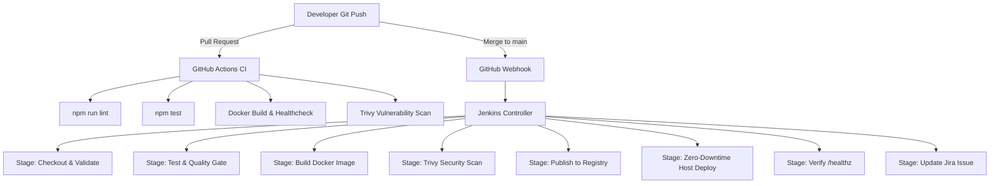

# SmartStock AI — Enterprise Inventory & POS System

[](https://github.com/phutaneprathamesh829-lang/smart-stock/actions/workflows/ci.yml)
[](https://hub.docker.com/r/phutaneprathamesh829/smart-stock)
[](LICENSE)
[](docs/DEVOPS_SETUP.md)

SmartStock AI is a single-page Enterprise Inventory Management and Store Point-of-Sale (POS) application packaged with an enterprise-grade Docker CI/CD delivery pipeline integrated across **GitHub Actions**, **Jenkins**, and **Jira Cloud**.

---

## 📑 Table of Contents
1. [Application Overview & Architecture](#application-overview--architecture)
2. [DevOps CI/CD Delivery Pipeline](#devops-cicd-delivery-pipeline)
3. [Quick Start (Local Development)](#quick-start-local-development)
4. [Docker & Container Deployment](#docker--container-deployment)
5. [Automated Testing & Quality Gates](#automated-testing--quality-gates)
6. [Jenkins Declarative Pipeline](#jenkins-declarative-pipeline)
7. [GitHub Actions Workflow](#github-actions-workflow)
8. [Jira Cloud Task Management Integration](#jira-cloud-task-management-integration)
9. [Project File Structure](#project-file-structure)
10. [Verification & Health Checks](#verification--health-checks)

---

## 1. Application Overview & Architecture

SmartStock AI provides an in-browser management suite with two primary access modes:
- **Admin Portal:** Live metrics dashboard, dynamic inventory management, low-stock threshold monitoring (`<= 5` units), product addition/modification/deletion, and category analytics (Chart.js).
- **Store POS & Customer Portal:** Real-time product browsing, category filtering, search, cart management, simulated UPI QR code checkout (`phutaneprathamesh829@oksbi`), and instant invoice generation (`ORD-XXXXXX`).

### Tech Stack:
- **Frontend:** HTML5, Modern Vanilla JavaScript (ES6+), Tailwind CSS (CDN), FontAwesome 6, Chart.js, QRCode.js.
- **Web Server:** Hardened Nginx 1.27 Alpine Linux (unprivileged non-root execution on port 8080).
- **Containerization:** Docker & Docker Compose.
- **CI/CD Automation:** GitHub Actions & Jenkins Declarative Pipeline.
- **Security Scanning:** Aquasecurity Trivy.
- **Task Management:** Jira Cloud (Project Key: `STOCK`).

---

## 2. DevOps CI/CD Delivery Pipeline



---

## 3. Quick Start (Local Development)

### Prerequisites:
- Node.js 18+ (for local test runner and static analysis)
- Docker & Docker Compose (for containerization)

### 1. Clone Repository:
```bash
git clone https://github.com/phutaneprathamesh829-lang/smart-stock.git
cd smart-stock
```

### 2. Configure Environment:
```bash
cp .env.example .env
```

### 3. Run Automated Tests & Linter:
```bash
npm run ci
```

### 4. Serve Locally (Without Docker):
```bash
# Using Node.js
npx serve . -p 8080

# Or using Python
python -m http.server 8080
```
Open [http://localhost:8080](http://localhost:8080) in your web browser.

---

## 4. Docker & Container Deployment

### 4.1 Running with Docker Compose (Recommended)

```bash
# Start production container in background
docker compose up -d --build smartstock

# Check container status and health
docker compose ps

# View live container logs
docker compose logs -f smartstock

# Stop container
docker compose down
```

### 4.2 Local Live Development Mode (Volume Sync)
Mount your local `index.html` live inside the container so code edits update instantly:
```bash
docker compose --profile dev up -d smartstock-dev
```

### 4.3 Manual Docker CLI Commands

```bash
# 1. Build the production image
docker build -t smartstock-app:latest .

# 2. Run container as non-root on port 8080
docker run -d \
  --name smartstock-container \
  --restart unless-stopped \
  -p 8080:8080 \
  smartstock-app:latest

# 3. Inspect container health status
docker inspect --format='{{json .State.Health}}' smartstock-container

# 4. View container logs
docker logs -f smartstock-container

# 5. Stop and remove container
docker stop smartstock-container
docker rm smartstock-container
```

---

## 5. Automated Testing & Quality Gates

The project contains automated tests running under the native Node.js test runner:

| Test Suite | File | What it Validates |
|------------|------|-------------------|
| **Linter & Static Analysis** | `tests/lint.js` | Validates `index.html` DOM elements, parses embedded JS syntax via `node:vm`, validates `nginx.conf`, `Dockerfile` best practices, and `compose.yaml`. |
| **Domain Integrity** | `tests/inventory.test.js` | Checks 6 seed products, unique SKUs, positive pricing, and category membership. |
| **Low Stock Alert Logic** | `tests/inventory.test.js` | Ensures products with `stock <= 5` trigger low-stock alerts. |
| **POS Cart & Checkout** | `tests/inventory.test.js` | Validates subtotal arithmetic, stock decrementing, and out-of-stock guards. |
| **Security & Auth** | `tests/inventory.test.js` | Tests password strength algorithm and `ORD-XXXXXX` format. |

Run tests anytime:
```bash
npm test        # Run unit tests
npm run lint    # Run static linter
npm run ci      # Run both
```

---

## 6. Jenkins Declarative Pipeline

The root [`Jenkinsfile`](file:///c:/Users/megha/Downloads/smartstock%20%282%29/smartstock/Jenkinsfile) executes a 10-stage delivery pipeline:

1. **Checkout SCM:** Clones Git repository, extracts 7-character commit SHA, builds immutable tag `${BUILD_NUMBER}-${GIT_COMMIT}`.
2. **Validate Environment:** Verifies presence of Docker, Curl, Node, and project assets.
3. **Install Dependencies:** Installs packages with `npm install`.
4. **Lint & Unit Tests:** Runs `npm run lint` and `npm test`. Fails pipeline on errors.
5. **Build Docker Image:** Builds image tagged with immutable tag and environment tag.
6. **Security Scan (Trivy):** Scans for `HIGH,CRITICAL` vulnerabilities.
7. **Publish Image:** Pushes versioned image to configured registry (`docker.io`, `ghcr.io`) using Jenkins credentials (`docker-registry-credentials`).
8. **Deploy Application:** Safely replaces container with automatic rollback backup tag.
9. **Verify Deployment:** Polls `http://localhost:8080/healthz` with retry loop. Triggers automatic rollback if verification fails.
10. **Update Jira:** Posts build and deployment status directly to the linked Jira issue via Jira REST API.

Detailed Jenkins configuration steps are in [`docs/DEVOPS_SETUP.md`](file:///c:/Users/megha/Downloads/smartstock%20%282%29/smartstock/docs/DEVOPS_SETUP.md).

---

## 7. GitHub Actions Workflow

The workflow at [`.github/workflows/ci.yml`](file:///c:/Users/megha/Downloads/smartstock%20%282%29/smartstock/.github/workflows/ci.yml) executes on every push and pull request:
- Runs static analysis and business logic unit tests.
- Builds Docker image and verifies `/healthz` HTTP response in runner.
- Executes Trivy vulnerability scanner.
- Publishes production container to GitHub Container Registry (`ghcr.io`) on merges to `main`.

---

## 8. Jira Cloud Task Management Integration

### Branch Naming Convention:
```bash
git checkout -b feature/STOCK-12-add-product-discount
```

### Commit Message Convention:
```text
STOCK-12: Implement discount calculator for checkout items
```

Detailed Jira Cloud configuration, Epics, Sprint Planning, and Smart Commits instructions are in [`docs/JIRA_SETUP.md`](file:///c:/Users/megha/Downloads/smartstock%20%282%29/smartstock/docs/JIRA_SETUP.md).

---

## 9. Project File Structure

```text
smartstock/
├── .github/
│   └── workflows/
│       └── ci.yml             # GitHub Actions CI/CD workflow
├── docs/
│   ├── DEVOPS_SETUP.md        # Jenkins, Webhook & Security Setup
│   ├── JIRA_SETUP.md          # Jira Cloud integration & automation
│   └── DEPLOYMENT.md          # Production deployment & rollback guide
├── tests/
│   ├── inventory.test.js      # Automated domain business logic tests
│   └── lint.js                # HTML, JS syntax & Nginx static linter
├── .dockerignore              # Docker build exclusion rules
├── .env.example               # Environment variables template
├── .gitignore                 # Version control exclusion rules
├── compose.yaml               # Docker Compose (production & dev profiles)
├── Dockerfile                 # Hardened, non-root Nginx Alpine Dockerfile
├── index.html                 # SmartStock AI Single Page Application
├── Jenkinsfile                # Root 10-stage Declarative Jenkins pipeline
├── nginx.conf                 # Production Nginx server configuration
├── package.json               # Node.js project metadata and test scripts
└── README.md                  # Project documentation
```

---

## 10. Verification & Health Checks

Verify your deployment anytime by calling the health endpoint:

```bash
curl -i http://localhost:8080/healthz
```

**Expected HTTP Response:**
```http
HTTP/1.1 200 OK
Content-Type: application/json
Content-Length: 64
Connection: keep-alive
X-Frame-Options: SAMEORIGIN
X-Content-Type-Options: nosniff
X-XSS-Protection: 1; mode=block

{"status":"UP","app":"smartstock-ai","service":"inventory-pos"}
```
