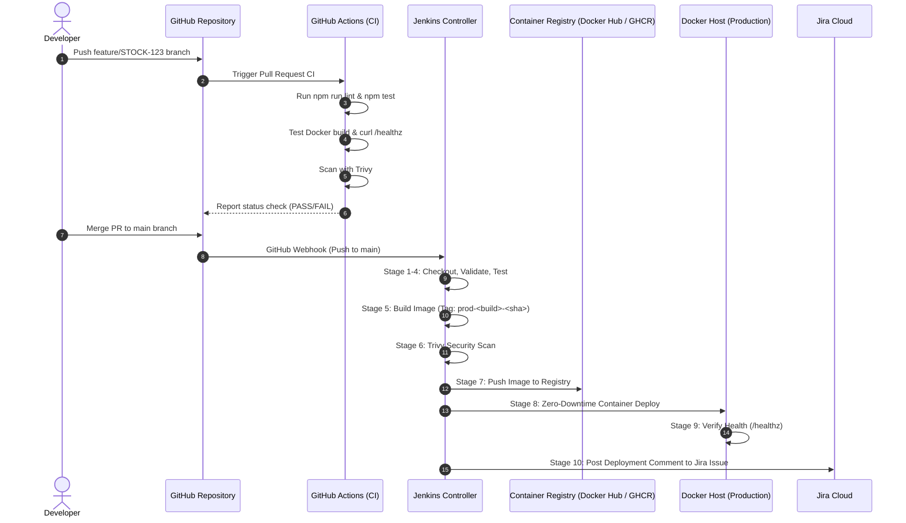

# DevOps Infrastructure & CI/CD Setup Guide — SmartStock AI

This guide provides instructions for configuring Jenkins, GitHub Webhooks, Docker agents, and Security Scanners for SmartStock AI.

---

## 1. CI/CD Architecture & Flow



---

## 2. Jenkins Controller Setup

### 2.1 Required Jenkins Plugins
Ensure the following plugins are installed via **Manage Jenkins** → **Plugins** → **Available plugins**:

1. **Pipeline** (workflow-aggregator)
2. **Git Plugin** (git)
3. **GitHub Integration Plugin** (github-pullrequest)
4. **Credentials Binding Plugin** (credentials-binding)
5. **Docker Pipeline** (docker-workflow)
6. **AnsiColor** (ansicolor) - for colored console logs
7. **Jira Plugin** or **Generic Webhook Trigger** (optional for advanced webhook filtering)

### 2.2 Configuring Jenkins Credentials
Go to **Manage Jenkins** → **Credentials** → **System** → **Global credentials** → **Add Credentials**:

| Credential ID | Kind | Value / Fields | Purpose |
|---------------|------|----------------|---------|
| `docker-registry-credentials` | Username with password | Docker Hub or GHCR username & Access Token | Publishing and pulling production images |
| `jira-api-token` | Secret text | Atlassian API Token | Updating Jira issue comments upon deployment |
| `github-webhook-secret` | Secret text | Shared secret string | Authenticating incoming GitHub webhooks |

### 2.3 Jenkins Agent Docker Access
If Jenkins runs as a Docker container, pass the host Docker socket into the Jenkins agent:

```bash
docker run -d \
  --name jenkins-controller \
  -p 8080:8080 -p 50000:50000 \
  -v jenkins_home:/var/jenkins_home \
  -v /var/run/docker.sock:/var/run/docker.sock \
  -u root \
  jenkins/jenkins:lts
```

Inside the Jenkins agent, ensure the `jenkins` user has permissions to interact with Docker:
```bash
# Add jenkins user to docker group
groupadd -g 999 docker || true
usermod -aG docker jenkins || true
chmod 666 /var/run/docker.sock || true
```

---

## 3. GitHub Webhook Configuration

To trigger Jenkins on push events without generating duplicate builds:

1. In your GitHub repository, open **Settings** → **Webhooks** → **Add webhook**.
2. **Payload URL:** `http://<your-jenkins-public-ip-or-domain>:8080/github-webhook/`
3. **Content type:** `application/json`
4. **Secret:** `<Your github-webhook-secret string>`
5. **Which events would you like to trigger this webhook?**
   - Select **Let me select individual events**:
     - Check: **Pushes**
     - Check: **Pull requests**
6. Click **Add webhook**.

> [!TIP]
> **Avoiding Duplicate Builds:**
> - Let **GitHub Actions** validate Pull Requests and feature branches (`npm test`, `npm run lint`).
> - Configure **Jenkins** to build on merges to `main` for delivery and deployment to production. In your Jenkins Pipeline job settings, specify the Branch Specifier as `*/main`.

---

## 4. Trivy Container Vulnerability Scanner

Trivy scans container images for CVEs and configuration issues.

### Running Standalone Trivy (Linux Agent):
```bash
# Install Trivy on Ubuntu/Debian
sudo apt-get install wget apt-transport-https gnupg lsb-release
wget -qO - https://aquasecurity.github.io/trivy-repo/deb/public.key | sudo apt-key add -
echo deb https://aquasecurity.github.io/trivy-repo/deb $(lsb_release -sc) main | sudo tee -a /etc/apt/sources.list.d/trivy.list
sudo apt-get update && sudo apt-get install trivy
```

### Running Containerized Trivy (Automatic Fallback in Jenkinsfile):
If Trivy is not installed natively, our `Jenkinsfile` automatically invokes containerized Trivy:
```bash
docker run --rm -v /var/run/docker.sock:/var/run/docker.sock \
  aquasec/trivy:latest image \
  --severity CRITICAL,HIGH \
  --exit-code 0 \
  phutaneprathamesh829/smart-stock:latest
```

---

## 5. Creating the Jenkins Pipeline Job

1. On Jenkins Dashboard, click **New Item**.
2. Enter name: `smartstock-ci-cd`.
3. Choose **Pipeline** and click **OK**.
4. In **Build Triggers**, check:
   - **GitHub hook trigger for GITScm polling**
5. In **Pipeline**:
   - **Definition:** Pipeline script from SCM
   - **SCM:** Git
   - **Repository URL:** `https://github.com/phutaneprathamesh829-lang/smart-stock.git`
   - **Branches to build:** `*/main`
   - **Script Path:** `Jenkinsfile`
6. Click **Save** and trigger an initial build by clicking **Build with Parameters**.
