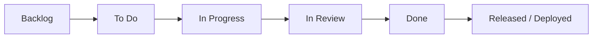

# Jira Cloud Integration Guide — SmartStock AI

This document details the complete end-to-end configuration for integrating **Jira Cloud** with GitHub, Jenkins, and the SmartStock AI DevOps delivery pipeline.

---

## 1. Jira Project Architecture

### 1.1 Project Settings
- **Project Name:** SmartStock AI
- **Project Key:** `STOCK`
- **Project Template:** Scrum or Kanban (Software Development)
- **Default Issue Types:**
  - **Epic:** High-level milestones or modules (e.g., `STOCK-1: DevOps & CI/CD Pipeline Implementation`)
  - **Story:** User-facing functional capabilities (e.g., `STOCK-2: Real-time Low Stock Warning`)
  - **Task:** Engineering & infrastructure items (e.g., `STOCK-3: Nginx Hardening & Healthcheck`)
  - **Bug:** Defect tracking (e.g., `STOCK-4: Fix Cart Total NaN on Empty Price`)
  - **Sub-task:** Atomic engineering tasks

### 1.2 Recommended Backlog & Epics
| Issue Key | Type | Summary | Priority | Acceptance Criteria |
|-----------|------|---------|----------|---------------------|
| `STOCK-1` | Epic | DevOps & CI/CD Pipeline Implementation | High | Automated GitHub CI, Jenkins pipeline, Docker containerization |
| `STOCK-2` | Task | Production Dockerization & Health Check | High | Multi-stage/hardened Nginx Alpine image running non-root on port 8080 with `/healthz` |
| `STOCK-3` | Task | GitHub Actions CI & Quality Gates | High | Automated linting, domain unit tests, Docker build validation, Trivy security scan |
| `STOCK-4` | Task | Declarative Jenkins CI/CD Pipeline | High | Complete 10-stage pipeline with registry publishing, automated deployment, and healthcheck |
| `STOCK-5` | Story | UPI Payment Modal & Invoice Generation | Medium | Verified checkout creates customer invoice with order ID `ORD-XXXXXX` |
| `STOCK-6` | Bug | Fix Docker Container Port Mismatch | High | Align container port 8080 with host port 8080 |

---

## 2. Issue Lifecycle & Workflow



- **Backlog / To Do:** Issue groomed and assigned to sprint.
- **In Progress:** Developer creates branch `feature/STOCK-<id>-...` and begins work.
- **In Review:** Pull Request created on GitHub. GitHub Actions CI runs lint and unit tests.
- **Done:** PR reviewed, approved, and merged to `main`.
- **Released / Deployed:** Jenkins builds, tests, publishes to registry, and deploys to target environment.

---

## 3. Git Branch & Commit Conventions

### 3.1 Branch Naming Convention
Always prefix branches with the issue type and the exact Jira issue key:

- **Features:** `feature/STOCK-123-description`
- **Bugfixes:** `bugfix/STOCK-456-fix-cart-calculation`
- **Hotfixes:** `hotfix/STOCK-789-nginx-permissions`
- **Chores:** `chore/STOCK-101-update-dockerignore`

*Example:*
```bash
git checkout -b feature/STOCK-2-docker-healthcheck
```

### 3.2 Commit Message Convention
Use Jira issue keys in commit headers:

```text
STOCK-123: Add health check endpoint to Nginx configuration

- Implemented /healthz route returning JSON HTTP 200
- Configured Docker HEALTHCHECK polling every 30s
- Added unit tests for endpoint specification
```

### 3.3 Smart Commits (Jira Cloud Built-in)
Jira automatically parses smart commit commands:
- **Comment:** `STOCK-2 #comment Deployed to staging via Jenkins build 14`
- **Time Tracking:** `STOCK-2 #time 2h 30m Working on Nginx configuration`
- **Transition:** `STOCK-2 #close` or `STOCK-2 #in-progress`

---

## 4. GitHub to Jira Cloud Integration

### Step 1: Install GitHub for Jira App
1. Go to **Jira Settings** (`⚙`) → **Apps** → **Find new apps**.
2. Search for **"GitHub for Jira"** (by Atlassian) and click **Get app**.
3. Select **Configure** and click **Connect GitHub Organization**.
4. Authenticate your GitHub account and select repository: `phutaneprathamesh829-lang/smart-stock`.

### Step 2: Set Up Jira Automation Rules
Navigate to **Project Settings** → **Automation** → **Create Rule**:

#### Rule 1: Move to "In Progress" on Branch Creation
- **Trigger:** DevOps / Branch created
- **Condition:** Issue status is "To Do"
- **Action:** Transition issue to "In Progress"

#### Rule 2: Move to "In Review" on PR Creation
- **Trigger:** DevOps / Pull request created
- **Condition:** Issue status is "In Progress"
- **Action:** Transition issue to "In Review", post comment: *"PR opened on GitHub for review: {{pullRequest.url}}"*

#### Rule 3: Move to "Done" on PR Merge
- **Trigger:** DevOps / Pull request merged
- **Condition:** Issue status is "In Review"
- **Action:** Transition issue to "Done", post comment: *"Merged into main branch by {{pullRequest.author.name}}"*

---

## 5. Jenkins to Jira Cloud Deployment Notifications

### Step 1: Generate Jira API Token
1. Log in to [https://id.atlassian.com/manage-profile/security/api-tokens](https://id.atlassian.com/manage-profile/security/api-tokens).
2. Click **Create API token**, label it `jenkins-cicd-token`, and copy the token.

### Step 2: Store Token in Jenkins
1. Go to **Manage Jenkins** → **Credentials** → **System** → **Global credentials**.
2. Click **Add Credentials**:
   - **Kind:** Secret text
   - **Scope:** Global
   - **Secret:** `<Your Jira API Token>`
   - **ID:** `jira-api-token`
   - **Description:** Jira Cloud REST API Token

### Step 3: Jira REST API Curl Test
You can verify your token locally or on your Jenkins agent:
```bash
# Set variables
JIRA_DOMAIN="your-domain.atlassian.net"
USER_EMAIL="your-email@example.com"
API_TOKEN="your_token_here"
ISSUE_KEY="STOCK-1"

# Post comment to issue
curl -s -X POST \
  -u "${USER_EMAIL}:${API_TOKEN}" \
  -H "Content-Type: application/json" \
  -d '{
    "body": {
      "type": "doc",
      "version": 1,
      "content": [{
        "type": "paragraph",
        "content": [{
          "type": "text",
          "text": "Jenkins deployment verification succeeded on environment [production]."
        }]
      }]
    }
  }' \
  "https://${JIRA_DOMAIN}/rest/api/3/issue/${ISSUE_KEY}/comment"
```
